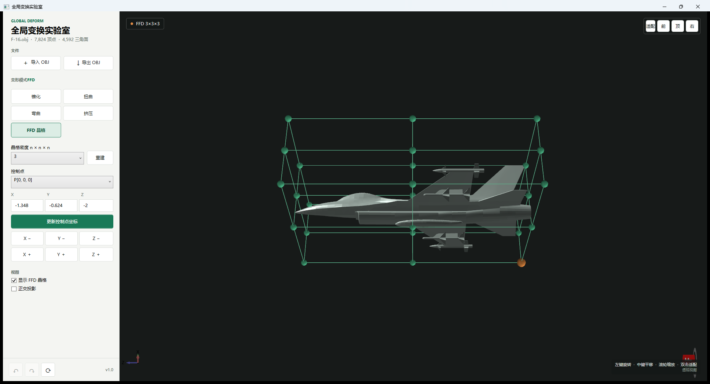

# 全局变换实验室

一个面向计算机图形学课程的 Windows 桌面演示程序。项目使用 .NET 8、WPF 和 HelixToolkit 实现，可导入 Wavefront OBJ 模型，并实时观察多种全局变形效果。



## 功能

- 导入和导出 `.obj` 模型，启动时内置一个 F-16 示例模型
- 锥化：沿 Y 轴按高度线性改变 XZ 截面
- 扭曲：沿 Y 轴逐层旋转截面
- 弯曲：将 Y 轴映射到圆弧，同时保持横截面
- 挤压：改变 Y 轴长度，并按体积近似守恒反向缩放 XZ 轴
- FFD：根据模型包围框建立 `n × n × n` 控制晶格，支持 2 到 5 阶网格
- 通过坐标输入、六向微调或视口点选修改 FFD 控制点，模型实时更新
- 支持撤销、重做、恢复导入状态、正交投影和轨迹球视图控制

## 直接运行

从仓库的 [Releases](../../releases) 下载 `GlobalDeformationLab.exe`。发布文件为 Windows x64 自包含单文件程序，不需要预装 .NET 运行时。

Windows 首次运行网络下载的 EXE 时可能显示 SmartScreen 提示。可在确认发布者与仓库来源后选择“更多信息”，再运行程序。

## 操作

1. 单击“导入 OBJ”选择模型，或直接使用启动时加载的 F-16。
2. 选择锥化、扭曲、弯曲或挤压，拖动参数滑块实时预览，单击“应用当前变形”提交结果。
3. 选择“FFD 晶格”，设置网格密度并选择控制点。编辑 X、Y、Z 坐标或使用六向按钮调整位置。
4. 使用左下角按钮撤销、重做或恢复模型。完成后可导出新的 OBJ 文件。

在 3D 视口中，左键拖动旋转，中键拖动平移，滚轮缩放，双击空白处适配全部模型。右上角工具条可一键恢复适配视图，或切换前、顶、右视图；FFD 模式中单击控制点可直接选中它。

## FFD 实现

程序先计算模型轴对齐包围框，并在包围框内均匀生成 `n × n × n` 个控制点。每个原始顶点映射到局部参数 `(s, t, u)`，终止位置由三维 Bernstein 基函数张量积计算：

```text
P'(s,t,u) = Σ Bi(s) Bj(t) Bk(u) Pijk
```

初始控制点与规则晶格重合，因此变换前后模型一致。移动任意控制点后，程序使用缓存的基函数权重重新计算全部顶点，并重建平滑法线。

## 从源码构建

要求 Windows 10/11 和 .NET 8 SDK：

```powershell
dotnet restore .\GlobalDeformationLab.sln
dotnet test .\GlobalDeformationLab.sln -c Release
.\build-release.ps1
```

发布结果位于 `artifacts\win-x64\GlobalDeformationLab.exe`。

## 项目结构

```text
GlobalDeformationLab/          WPF 桌面应用
  Core/                        全局变换与 FFD 数学
  IO/                          OBJ 导入和导出
  Rendering/                   WPF 3D 网格与法线生成
GlobalDeformationLab.Tests/    算法及 OBJ 往返测试
.github/workflows/             Windows 持续集成构建
```

## 许可

MIT License
